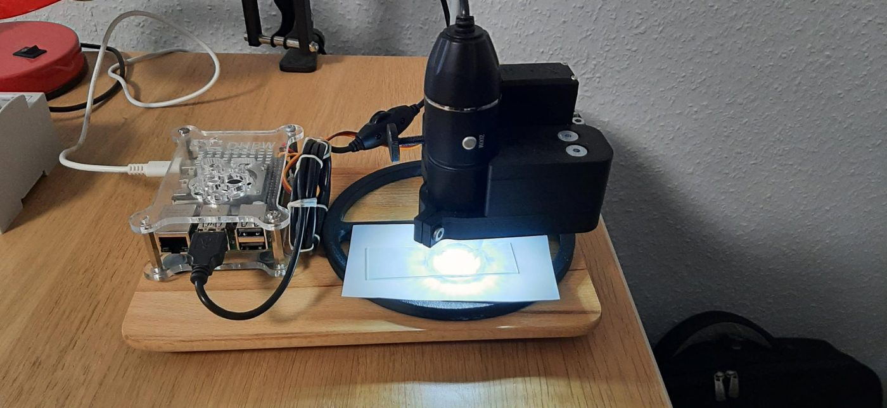
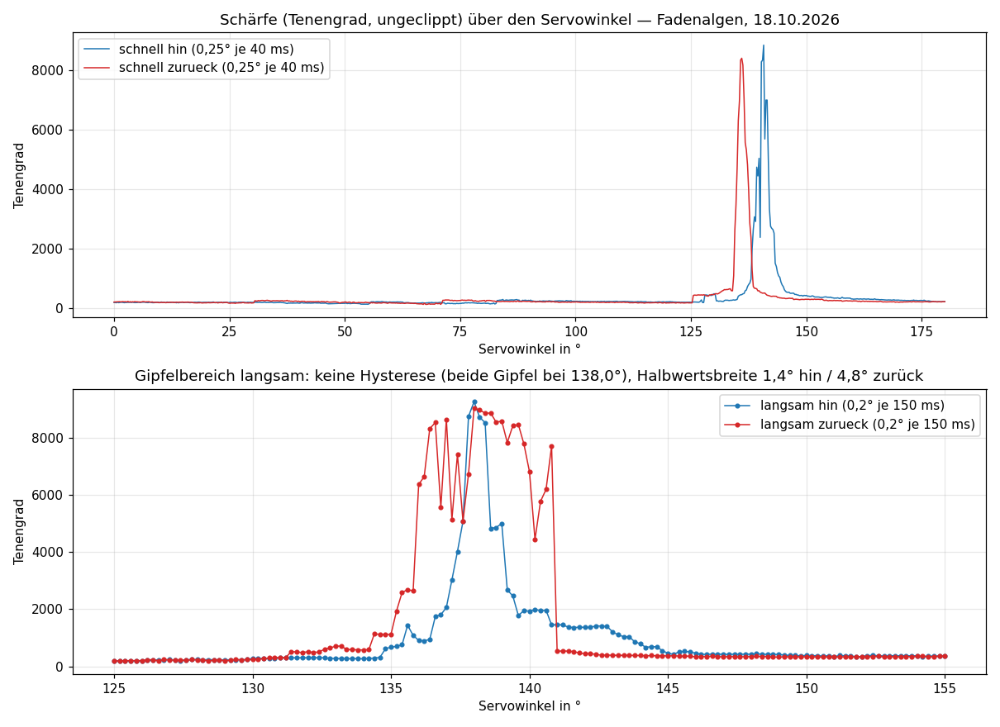

# Mikroskop-Autofokus mit Servo am Raspberry Pi 5

**Autoren:** Prof. Dr.-Ing. Ralph Wystup M.Sc. und Claude (Anthropic, Claude Code) — gemeinsam erstellt · Fassung 4 vom 18.10.2026

**Seite:** https://ralphwystup.github.io/Mikroskop-Autofokus-mit-Servo-am-Raspberry-Pi-5/ — Hardware und Verschaltung, Beschreibung
und Ablauf, Manuskript mit den Methoden, alle Messungen, Zusammenarbeit mit der KI. Dieselbe Seite läuft live auf dem Pi
unter `http://mikroskop:8090` mit Bild, Kurve und Knöpfen.

Ein einfaches USB-Mikroskop (640 × 480) wird von einem Modellbauservo über ein Zahnradpaar (1 : 2, 3D-gedruckte Halterung) am
Rändelrad scharf gestellt. Ein Programm auf dem Raspberry Pi 5 misst die Bildschärfe (Tenengrad), fährt den Servo über die Hardware-PWM
und findet den Gipfel in 70 s: Suchlauf, Stapel mit Parabel, Anfahrt von unten mit Nachprüfung über die Schärfe. Bedienung im Browser, mit elektronischem Zoom in der Anzeige.

## Was gemessen wurde (18.10.2026, Fadenalgen)

| Frage | Befund |
|:--|:--|
| Software-PWM (RPi.GPIO/lgpio) | zittert: Schärfe ±47–63 % im Stand → Hardware-PWM (`dtoverlay=pwm-2chan`): ±0,7–0,9 % |
| Spiel von Servo + Getriebe | 4,6° zwischen Hin- und Rückweg → jedes Ziel wird nur von unten angefahren |
| Kleine Schritte aus dem Stand | 0,2°: 1 von 6 wirksam; mit 150 ms Rütteln ±0,6°: 6 von 6 |
| Nachlauf | schneller Lauf täuscht 4,75° Hysterese vor; 250 ms Ruhe vor jeder Messung |
| Rütteln am gespannten Getriebe | lässt es zurückschnappen (8 813 → 193) → Handschritte beider Richtungen über den Umweg von unten |
| Halten im Stand | Puls an: 12 von 12 Handschritte, knurrt · stromlos: still, 1 von 10 rutscht ab (auf der Seite wählbar) |
| Autofokus, sechs Läufe | 93–105 % der Parabelhöhe, Gipfel 139,6–140,1°, 70 s; Nachfokus 30 s |

## Was drin ist

| Datei | Inhalt |
|:--|:--|
| `autofokus4.py` | das Programm: Kamera, Schärfemaß, Servo (sysfs-PWM), Autofokus, Nachfokus, Handschritte, Befund-Paket, Seite auf Port 8090 |
| `seite.html` | die Bedien- und Dokumentationsseite (sechs Reiter), liegt neben dem Programm |
| `index.html` | dieselbe Seite für GitHub Pages, Livebild als Standbild |
| `pi/` | Dienst (`mikroskop-fokus.service`), Autostart-Fenster, `EINRICHTEN.md` |
| `bruecke/pi.py` | der Weg der KI zum Pi: SSH mit Schlüssel über den Arbeitsrechner (kein Passwort gespeichert) |
| `messung/` | die Messskripte (Stick-Slip, Hardware-PWM, Rütteln) und die Messdaten als CSV, Befundblatt |
| `bilder/` | Fotos des Aufbaus (19.10.2026), Schärfekurve, Fokusbild |

Vorarbeit des Auftraggebers (April–Juni 2026, Servo+Schärfe_Funktioniert_*.py, autofocus_clean/) liegt auf dem Pi in
`~/Desktop/historie_bis_2026-10-18/`; sie hatte das Schärfemaß bei 1,0 abgeschnitten (Plateau) und Software-PWM.

## Quellen

- J. Knapper et al., Fast, high-precision autofocus on a motorised microscope (OpenFlexure), Journal of Microscopy 2022, arXiv 2109.06842 — Anfahrt aus einer Richtung, Stapel mit Polynom.
- S. Pertuz, D. Puig, M. A. García, Analysis of focus measure operators for shape-from-focus, Pattern Recognition 46 (2013).
- Raspberry Pi: RP1-Hardware-PWM, Overlay `pwm-2chan`.

Lizenz: MIT (`LICENSE`).
